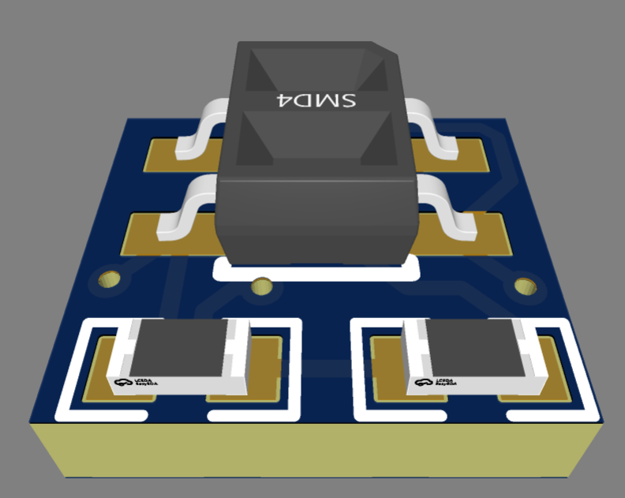

# QTR-SENSOR

A compact reflective floor sensor designed for mini sumo and sumo robots. Unlike conventional sensors with through-hole terminals, this design features SMD-style solder pads for direct wire soldering, providing a compact and low-profile connection.

Designed for floor detection in sumo robotics competitions, it can be used to detect the white boundary line and help the robot avoid leaving the ring.
## 3D Model Design

